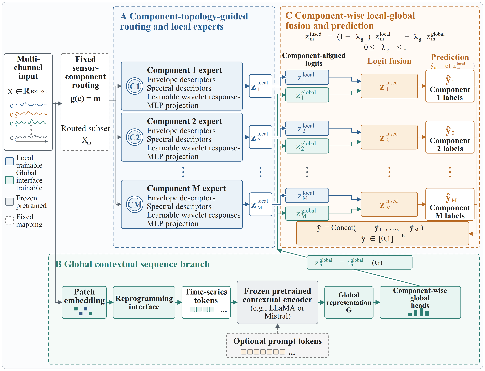
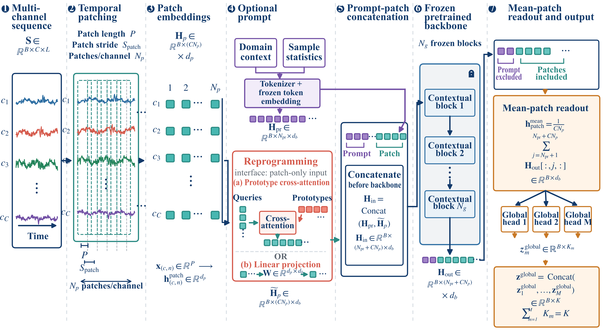

# PM-LLMoE

**A Component-Topology-Guided Local-Global Framework with Contextual Sequence Encoders for Industrial Time-Series Fault Diagnosis**

[](LICENSE)
[](https://www.python.org/)
[](https://pytorch.org/)

PM-LLMoE is a multichannel, multilabel fault-diagnosis framework designed to
preserve component-attributed evidence while modeling temporal and
cross-component context. It combines a deterministic sensor-component routing
prior and component-specific local experts with a configurable global sequence
encoder. The public implementation supports frozen pretrained LLaMA and Mistral
backbones, compact trainable or frozen Transformers, prompt controls,
reprogramming controls, and routing ablations through one entry point.

This repository contains the public research core required to inspect, train,
evaluate, and audit the disclosed method. It intentionally excludes datasets,
pretrained decoder files, trained checkpoints, cached arrays, predictions,
logs, manuscript material, private experiment orchestration, and third-party
baseline source trees.

## Why PM-LLMoE?

- **Component-attributed local evidence.** Known sensor-component
  correspondence routes each channel to a dedicated local expert instead of
  learning an unconstrained expert assignment from labels alone.
- **Local-global modeling.** The local branch extracts component-specific
  envelope, spectral, and learnable wavelet descriptors, while the global
  branch encodes the complete multichannel sequence as temporal patches.
- **Configurable global encoder.** The same interface supports frozen
  pretrained decoders, compact trainable Transformers, and frozen-random
  controls, making mechanism comparisons reproducible without changing the
  local branch or label space.
- **Explicit multi-label supervision.** Component-aligned local and global
  logits are fused before prediction, with Dynamic Focal Loss and alternative
  imbalance-aware objectives available from the training entry point.
- **Leakage-aware evaluation.** Source-aware, condition-temporal metadata keeps
  held-out operating conditions outside optimization, normalization fitting,
  class weighting, early stopping, and threshold calibration.
- **Checkpoint safety.** Trainable-only checkpointing is enabled by default and
  rejects any save that contains registered frozen decoder weights.

## Architecture

### Local-global framework

The same normalized multichannel input feeds two parallel paths. The local path
uses the predefined topology to build component-specific evidence. The global
path preserves the complete sequence and produces a shared contextual
representation. Component-aligned logits from both paths are fused in the
common multilabel space.



**Figure 1.** PM-LLMoE overview: component-topology-guided local experts, a
parallel contextual sequence branch, and component-wise logit fusion.

### Patch, prompt, and backbone interface

The global branch unfolds each channel into temporal patches, embeds the
patches, and maps them into the backbone hidden space. The canonical interface
uses prototype cross-attention; a direct linear projection is available as a
controlled alternative. Optional prompt tokens are prepended before the frozen
backbone, but only patch positions contribute to mean-patch readout.



**Figure 2.** Generic patch-prompt-interface-backbone pipeline. Dataset- and
experiment-specific dimensions are configured at runtime.

## Repository Contents

| Path | Purpose |
|---|---|
| `models/TimeLLM.py` | Canonical PM-LLMoE model and global-encoder controls |
| `models/moe_ffn.py` | Component-specific experts and routing variants |
| `models/frozen_decoder_backbone.py` | Frozen decoder adapter |
| `run_main.py` | Training, validation, testing, artifact export, and safe checkpoint loading |
| `data_provider/` | PHM dataset loading and split-metadata integration |
| `scripts/split/` | Condition-temporal split construction |
| `scripts/audit/` | Split-leakage audit |
| `scripts/run_bjtu_m0.sh` | Canonical BJTU training entry |
| `scripts/run_bjtu_ablation.sh` | Mechanism-control entry |
| `scripts/evaluate_heldout.py` | Validation-calibrated held-out evaluation |
| `scripts/verify_checkpoint_keys.py` | Trainable-only checkpoint audit |
| `external/mcc5/` | MCC5-THU dataset and model adapters |

## Reproduction Guide

### 1. Create an environment

Python 3.10 or later is recommended. Install PyTorch for the CUDA version on
your system, then install the remaining dependencies:

```bash
conda create -n pm_llmoe python=3.10 -y
conda activate pm_llmoe

# Install the appropriate PyTorch build first when required by your CUDA setup.
python -m pip install -r requirements.txt
```

No dependency installation script downloads a dataset or pretrained model.

### 2. Prepare external assets

Obtain BJTU-RAO and any pretrained decoder from their official distributors and
accept the corresponding licenses. Keep these assets outside Git. A typical
local layout is:

```text
PM-LLMoE/
├── dataset/
│   └── Training_new/        # BJTU-RAO CSV hierarchy; not tracked
├── LLMs/
│   └── llama-7b/            # local decoder/tokenizer files; not tracked
└── cache_data/              # generated metadata and caches; not tracked
```

The expected CSV hierarchy and the MCC5 manifest contract are documented in
[`docs/DATA_PREPARATION.md`](docs/DATA_PREPARATION.md). Do not commit dataset
files, split instances containing machine-specific absolute paths, or model
weights.

### 3. Build and audit the BJTU condition-temporal split

Create the split with a dry run first. Conditions 1-6 form the development
pool; conditions 7-9 remain held out. The 60%/15%/15% temporal allocation uses
90% of each seen-condition source trajectory, and the terminal 10% remains
unused. A 1,024-sample embargo removes boundary-adjacent windows.

```bash
python scripts/split/build_condition_temporal_split.py \
  --root_path ./dataset/Training_new \
  --seq_len 512 \
  --window_stride 1024 \
  --seen_conditions 1,2,3,4,5,6 \
  --heldout_conditions 7,8,9 \
  --train_ratio 0.60 \
  --val_ratio 0.15 \
  --test_ratio 0.15 \
  --embargo 1024 \
  --output_dir ./cache_data/splits_condition_temporal \
  --dry_run
```

After reviewing the dry-run report, create the metadata and run the leakage
audit:

```bash
python scripts/split/build_condition_temporal_split.py \
  --root_path ./dataset/Training_new \
  --seq_len 512 \
  --window_stride 1024 \
  --seen_conditions 1,2,3,4,5,6 \
  --heldout_conditions 7,8,9 \
  --train_ratio 0.60 \
  --val_ratio 0.15 \
  --test_ratio 0.15 \
  --embargo 1024 \
  --output_dir ./cache_data/splits_condition_temporal \
  --write

python scripts/audit/audit_condition_temporal_split.py \
  --metadata ./cache_data/splits_condition_temporal/metadata.json
```

Do not continue to training unless the audit completes successfully.

### 4. Train the canonical BJTU model

The canonical script uses a 512-point input, 1,024-sample data-window stride,
128-point patches, patch stride 8, eight active decoder blocks, mean-patch
readout, DFL-detach, mixed precision, and trainable-only checkpoints.

```bash
export DATA_ROOT=./dataset/Training_new
export SPLIT_METADATA=./cache_data/splits_condition_temporal/metadata.json
export LLM_MODEL_PATH=./LLMs/llama-7b
export CHECKPOINT_ROOT=./checkpoints/pm_llmoe_m0
export SEED=2026

bash scripts/run_bjtu_m0.sh
```

For a three-seed run, keep the split metadata and configuration fixed:

```bash
for seed in 2026 2027 2028; do
  SEED="$seed" \
  CHECKPOINT_ROOT="./checkpoints/pm_llmoe_m0_seed${seed}" \
  bash scripts/run_bjtu_m0.sh
done
```

### 5. Run mechanism controls

Run one variant at a time with the same split and seed:

```bash
VARIANT=M2_lite_trainable \
DATA_ROOT=./dataset/Training_new \
SPLIT_METADATA=./cache_data/splits_condition_temporal/metadata.json \
LLM_MODEL_PATH=./LLMs/llama-7b \
SEED=2026 \
bash scripts/run_bjtu_ablation.sh
```

Supported variants:

| Variant | Global path | Prompt | Interface |
|---|---|---|---|
| `M0_full` | Frozen pretrained LLaMA | Full | Reprogramming |
| `M1_pm_moe_only` | None | None | Not used |
| `M2_lite_trainable` | Compact trainable Transformer | None | Linear-compatible |
| `M3_lite_frozen` | Compact frozen-random Transformer | None | Linear-compatible |
| `M4_random_llama_shape` | Frozen random LLaMA-shape encoder | Full | Reprogramming |
| `M5_no_prompt` | Frozen pretrained LLaMA | None | Reprogramming |
| `M9_linear_projection` | Frozen pretrained LLaMA | Full | Linear projection |

The mechanism controls are architectural comparisons, not evidence of
language-style reasoning or isolated causal effects.

### 6. Evaluate a held-out checkpoint

The evaluator loads a trainable-only checkpoint, calibrates per-label thresholds
on the seen-condition validation split, and applies the fixed thresholds to the
held-out conditions without adaptation:

```bash
python scripts/evaluate_heldout.py \
  --checkpoint /path/to/checkpoint.pt \
  --config /path/to/config.json \
  --split-metadata ./cache_data/splits_condition_temporal/metadata.json \
  --output-dir ./results/heldout/seed2026 \
  --batch-size 16 \
  --seed 2026 \
  --variant PM-LLMoE
```

### 7. Verify checkpoint safety

The public entry point enables `--save_trainable_only` by default. It rejects a
save attempt if a registered frozen decoder would be serialized. Audit an
existing checkpoint with:

```bash
python scripts/verify_checkpoint_keys.py /path/to/checkpoint.pt
```

The report must show:

```text
llm_model_keys: 0
frozen_backbone_keys: 0
```

### 8. Preserve run artifacts

Each experiment directory should retain the following files when the
corresponding export options are enabled:

- `config.json`
- `metrics.json`
- `predictions.npz`
- `trainable_param_report.json`
- `checkpoint_key_report.json`
- `latency.json` when inference profiling is enabled

Record the split-metadata hash, random seed, decoder identity and revision,
active block count, routing mode, prompt mode, interface mode, loss, and readout
mode. See [`docs/REPRODUCIBILITY.md`](docs/REPRODUCIBILITY.md) for the complete
checklist.

## MCC5-THU External Validation

The public MCC5 adapter uses recording/window manifests, train-only
normalization metadata, measurement-location groups, and recording-level
aggregation. Dataset files and private manifests are not redistributed. See
[`external/mcc5/README.md`](external/mcc5/README.md) and
[`docs/DATA_PREPARATION.md`](docs/DATA_PREPARATION.md) for the public adapter
contract.

## Third-Party Baselines

TimeMIL, TimesNet, and other external baseline implementations are not vendored
here. Obtain them from their official repositories and review their licenses
before use. The shared split, normalization, threshold-calibration, seed, and
reporting requirements are summarized in
[`baselines/README.md`](baselines/README.md).

## Public Release Boundary

Before creating a public commit, run:

```bash
python scripts/check_release_safety.py --root .
```

The command must exit with `status: PASS`. Then manually inspect the Git index
to confirm that no dataset, pretrained model, checkpoint, cache, prediction,
log, credential, machine-specific path, third-party source tree, or private
research module is staged. The complete boundary is documented in
[`docs/RELEASE_SCOPE.md`](docs/RELEASE_SCOPE.md).

## License

The public PM-LLMoE code is distributed under the Apache License 2.0. Datasets,
pretrained models, and third-party implementations remain subject to their own
licenses and are not redistributed by this repository.
